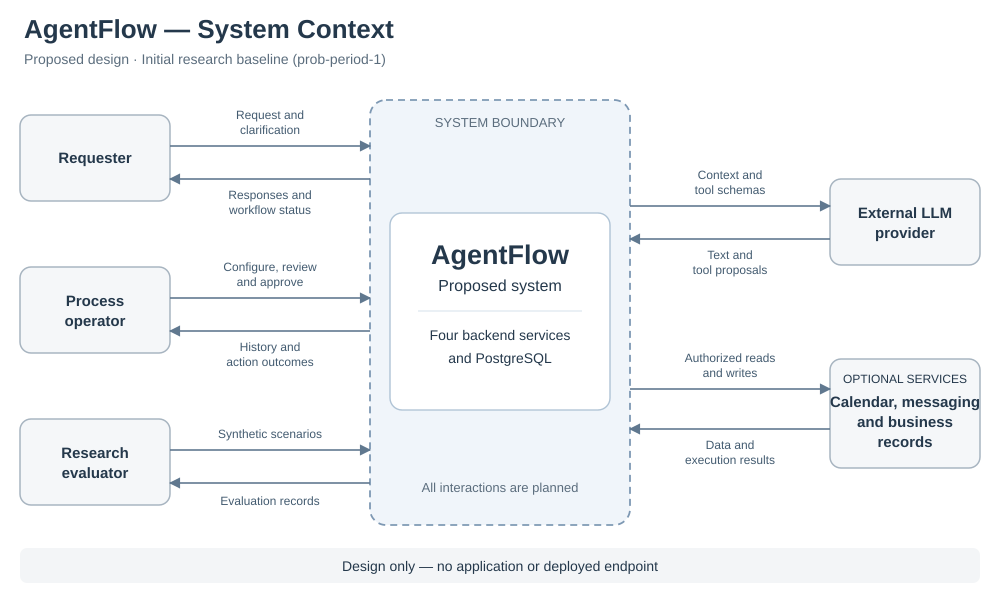
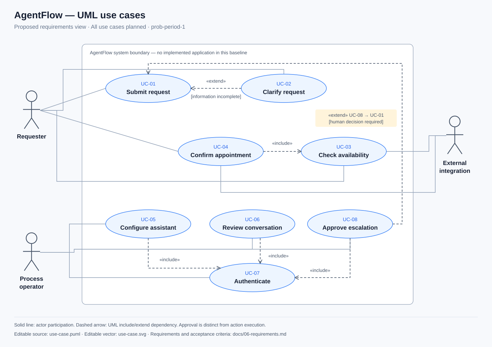
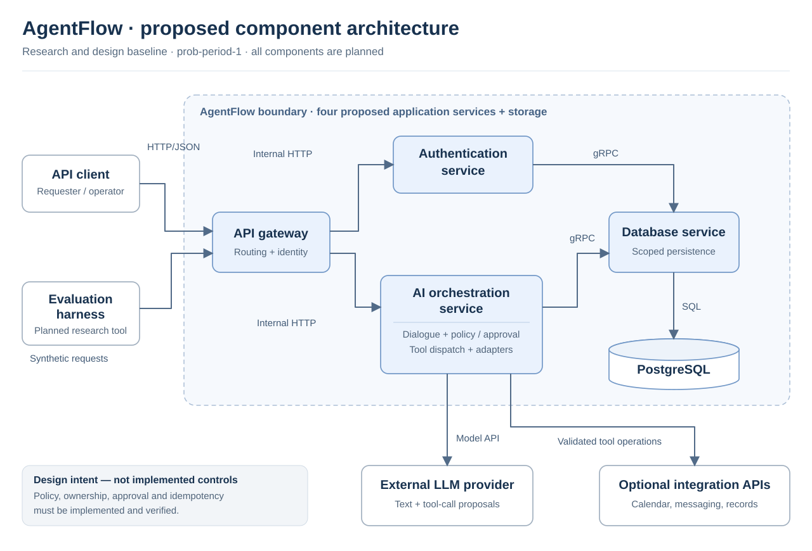

# 07 — Proposed architecture and diagrams

**Project:** AgentFlow

**Diploma topic:** Development of an Intelligent Business Process Automation System Based on Large Language Models and AI Agents

**Baseline:** `prob-period-1`, 23 October 2026

This document describes a proposed design. The baseline contains no application implementation or running services. Diagram edges describe planned responsibilities and communication; they are not runtime evidence.

## Architecture decision

The proposed backend has four Go services: API gateway, authentication, AI orchestration and database access. HTTP/JSON connects clients to the gateway and gateway to HTTP services. gRPC is proposed for the typed data interface. PostgreSQL stores users, assistant configurations, conversations, messages and action records.

The separation gives access control, orchestration and persistence distinct responsibilities. Its costs are additional deployment complexity, network failure modes and cross-service consistency. A simpler monolith remains a valid alternative; this baseline proposes service boundaries to study integration and controlled automation, without claiming a performance advantage.

The proposed AI agent uses a bounded cycle: load context, request a model response, validate a tool proposal, execute an allowed action, return its result to the model and save the outcome. Planner, executor and reviewer denote logical responsibilities inside orchestration. A network of independently communicating agents is not a baseline requirement.

## Context diagram

Editable source: [context.mmd](../diagrams/context.mmd); editable vector: [context.svg](../diagrams/context.svg).

The AgentFlow system boundary includes the proposed backend and storage. A requester submits a service request through an API or a future messaging adapter. An operator configures assistants, reviews conversations and approves escalations through the API. An external LLM provider proposes text and tool calls; it does not directly write to storage. Optional calendar, messaging and business-record systems receive approved integration operations. A researcher supplies synthetic scenarios and collects evaluation records.

Integrations are grouped by function so that the design is independent of any specific organization. The first evaluation should use deterministic test doubles. There is no frontend or deployed public endpoint at this milestone.

## UML use-case diagram

Editable UML source: [use-case.puml](../diagrams/use-case.puml); editable vector: [use-case.svg](../diagrams/use-case.svg).

| ID | Use case | Actor | Intended behavior |
|---|---|---|---|
| UC-01 | Submit request | Requester | Accept text and initiate a conversation workflow. |
| UC-02 | Clarify request | Requester | Ask for required missing information and preserve context. Extends UC-01 when information is incomplete. |
| UC-03 | Check availability | Requester; external integration | Read a configured availability source and return valid candidate slots. |
| UC-04 | Confirm appointment | Requester; external integration | Validate explicit requester confirmation and create one booking only after any policy-required operator approval. Includes UC-03 as a required step in the target workflow. |
| UC-05 | Configure assistant | Operator | Set the assistant's purpose, policy and allowed tools. Requires UC-07. |
| UC-06 | Review conversation | Operator | Inspect authorized dialogue, summaries and action outcomes. Requires UC-07. |
| UC-07 | Authenticate | Operator | Establish an authenticated session before protected operations. |
| UC-08 | Approve escalation | Operator | Approve or reject a pending action. Extends request handling when a policy requires a human decision and includes authentication. |

All cases are planned. UML `include` means required reused behavior; `extend` means conditional behavior. This is a requirements view rather than an execution sequence. In particular, “confirm appointment” describes the target business outcome, not an implemented action.

## Draft component diagram

Editable UML source: [components.puml](../diagrams/components.puml); editable vector: [components.svg](../diagrams/components.svg).

| Proposed component | Responsibility | Intended interface |
|---|---|---|
| API gateway | Route requests, validate authenticated identity, enforce input limits and forward a trusted identity context. | HTTP/JSON API; proposed contract in [openapi.yaml](../prototypes/openapi.yaml). |
| Authentication service | Verify credentials, issue/refresh/revoke sessions and support role checks. | Internal HTTP endpoints; database gRPC client. |
| AI orchestration service | Manage conversation state, call the LLM, dispatch tools, evaluate action policy, collect human decisions and build responses. | Internal HTTP endpoints; LLM API; integration adapters; database gRPC client. |
| Database service | Expose typed persistence operations and enforce scoped data access. | Proposed gRPC contract; PostgreSQL connection. |
| PostgreSQL | Store users, assistants, conversations, messages, action records and session records. | Relational tables and transactions. |
| Integration adapters | Translate allowed actions into calendar, messaging or business-record calls. These are modules within orchestration, not extra application services. | Narrow read/write interfaces with replaceable test doubles. |
| Evaluation harness | Replay scenarios, run manual/scripted/LLM comparisons, inject faults and record metrics. It is an external research tool. | The same business inputs and fixture services for all compared methods. |

All components are proposed. Policy validation, approval and idempotency are designed inside orchestration; they must be implemented and verified before the system can claim controlled automation. The diagram contains four application services plus storage, external providers and a research harness.

## Proposed request flow

1. A client sends an HTTP request to the gateway. The gateway validates the session and derives identity from it, rather than trusting a caller-supplied owner field.
2. The gateway routes authentication requests to the authentication service and workflow requests to orchestration.
3. Orchestration retrieves the authorized assistant configuration and conversation context through the database service.
4. The LLM receives the request, relevant context and allowed tool definitions. The response is treated as an untrusted proposal.
5. The policy layer checks tool name, JSON schema, semantic constraints, ownership and action budget. A protected action becomes `pending_approval` until an authorized human approves it.
6. An adapter executes an approved action using an idempotency key. Its actual result returns to orchestration and then to the model if further explanation is needed.
7. The system saves dialogue and action outcomes, returning a response that distinguishes completion, pending approval and failure.

No transaction spans every external service. The implementation must explicitly handle retries, partial failure and reconciliation. A model statement is never evidence that an external action succeeded.

## Proposed data model

The core relations are **User → Assistant → Conversation → Message**. An `Action` references its conversation, tool, idempotency key, policy decision and execution outcome. A session/refresh-token entity supports authentication. A future organization/tenant identifier must be derived from authenticated membership and included in data-access scope.

Initial action states are `pending_approval`, `approved`, `executing`, `reconciling`, `succeeded`, `failed` and `rejected`. A timeout after possible external acceptance moves an action to `reconciling`; the system must determine its outcome using the same action identity before retrying. The design must define legal transitions and atomic state changes before execution. A failed operation must not silently become `succeeded`; retries must preserve the same logical action identity.

This is a logical model, not a database schema delivered in the baseline. Detailed migrations, indexes, retention policy and concurrency behavior remain implementation decisions.

## Trust boundaries and validation

The design has four principal boundaries: external client to gateway; gateway to internal services; application services to persistence; and orchestration to LLM/integration providers. Conversation text, model output, callback data and tool-returned text are untrusted. Authentication, tenant separation, transport protection and ownership checks are planned requirements, not assumed guarantees.

The target deployment exposes only the gateway. Internal-service identity must be authenticated; a forged HTTP header must not grant access. Secrets belong in environment/secret storage. The experiment uses synthetic contact data, sandbox integrations and sanitized logs. Sensitive writes require explicit approval or a clearly documented policy authorizing that class of action.

## Decisions to validate during implementation

- Compare the operational cost of four services with a simpler deployment; keep interfaces narrow enough to combine services if warranted.
- Choose an LLM endpoint/model only after evaluating quality, latency, reproducibility and data-handling requirements.
- Set history limits, tool-call budgets, deadlines and retry policies before testing failure cases.
- Design adapter interfaces and deterministic fixtures before enabling real integrations.
- Specify tenant ownership and approval state transitions before implementing write endpoints.

Diagrams are maintained as source and SVG together. See [diagram maintenance notes](../diagrams/README.md). Future milestone tags should version requirements, contracts, implementation and evidence together.
